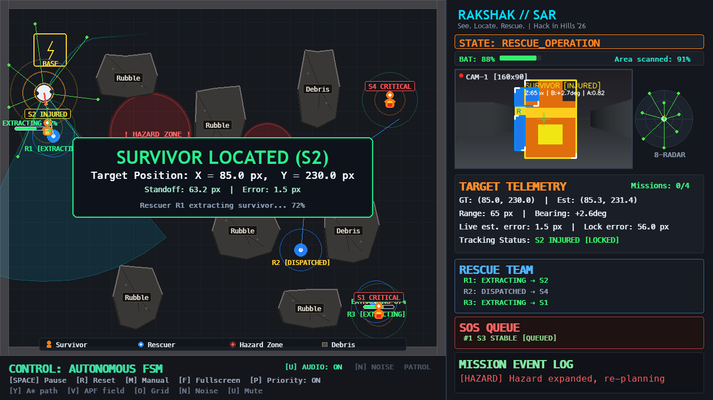
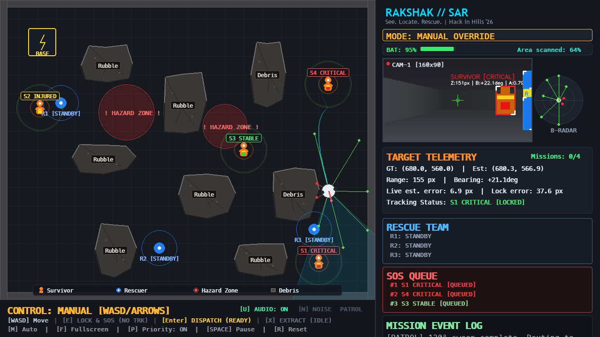
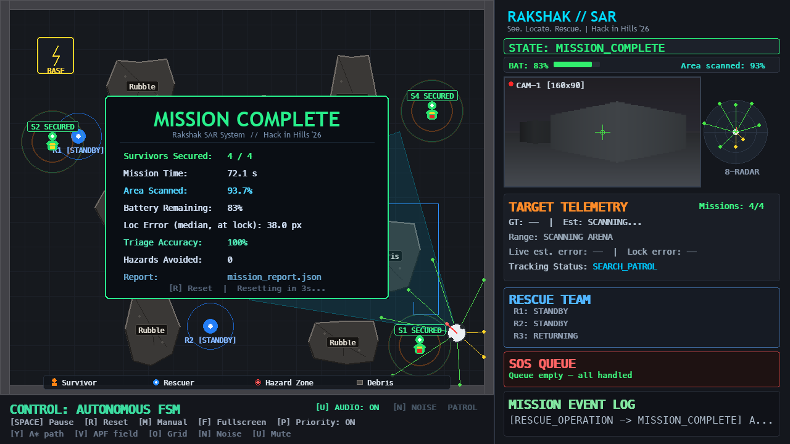

# Rakshak // Autonomous Search-and-Rescue Robot
### *"See. Locate. Rescue."*

**Hackathon:** Hack in Hills '26 &nbsp;|&nbsp; **Problem Statement:** PS 01 — Autonomous Vision-Guided Robot  
**Demo:** [▶ YouTube Demo (Placeholder)](https://youtu.be/placeholder) &nbsp;|&nbsp; **Screenshots:** [docs/screenshots/](docs/screenshots/)

---

## Problem Statement (PS 01)

> *"Build an autonomous robot that uses an AI-powered vision system to understand its surroundings,
> identify relevant objects and people, and navigate autonomously toward a given objective while
> detecting and avoiding obstacles. Real or simulated environment is allowed."*

Rakshak answers this challenge with a complete 2-D disaster simulation: a scout robot patrols
rubble-filled terrain, detects survivors through a synthetic camera, triages them by severity, and
dispatches up to three rescuers in priority order — all without human intervention.

## Screenshots

| Autonomous Mid-Mission | Manual Teleoperation Mode | Mission Complete Report |
|:---:|:---:|:---:|
|  |  |  |

---

## Key Features

| Feature | Details |
|---------|---------|
| **Autonomous FSM** | 6-state mission controller: `SEARCH_PATROL → VERIFY_TARGET → PLAN_ROUTE → NAVIGATE → RESCUE_OPERATION → MISSION_COMPLETE` |
| **Vision pipeline** | Synthetic 160×90 camera → OpenCV HSV segmentation → contour analysis → range/bearing estimation |
| **Honest triage** | 8-frame majority-vote (≥60%) on perceived detector labels; ground truth never used for dispatch |
| **Triage-priority dispatch** | CRITICAL → INJURED → STABLE, with concurrent R1/R2/R3 rescuers |
| **Priority Mode** | Full 90% area sweep before rescue; queue sorted by triage rank then distance |
| **A* planning** | Global path on 800×640 occupancy grid with obstacle inflation |
| **APF avoidance** | Artificial Potential Field with tangential vortex force (no local-minima traps) |
| **Dynamic hazards** | Zones grow +0.5 px/s; robot replans automatically on expansion |
| **Camera noise** | Gaussian pixel noise + drifting smoke haze (toggle `N`) |
| **Fullscreen** | `F`/`F11`; Retina-safe letterbox scaling; mouse coords remapped |
| **Manual override** | `M` → steer with WASD, `E` lock, `Enter` dispatch, `X` extract |
| **96 tests** | Full pytest suite covering FSM, tracker, detector, vision, dispatch, coverage, hazard, manual mode, triage, seed reproducibility |

---

## Architecture

```
┌────────────────────────────────────────────────────────────┐
│                         app.py                             │
│          RakshakApp  (main loop · render · input)          │
└──────┬──────────┬─────────────┬──────────────┬────────────┘
       │          │             │              │
    fsm.py   rescuer.py     sound.py       arena.py
  MissionFSM  DispatchMgr   SoundMgr    DisasterArena
       │          │                          │
    robot.py   camera.py               astar.py / apf.py
    Robot     Camera+noise             Path planners
       │
  detector.py ──► tracker.py ──► coverage.py
  Vision pipeline  Smoothing     Area tracking
```

### How Vision Works

```
Arena frame (800×640)
   │
   ▼ camera.py — rasterise 160×90 first-person buffer every 2 frames
   │
   ▼ detector.py — HSV mask (orange: H 7-25) bounded to triage badge area
                   contour analysis → bbox, range Z, bearing θ
   │
   ▼ tracker.py — nearest-estimate data association (gate 85 px)
                  EMA smoothing (α=0.35)
                  8-frame majority vote ≥60% → perceived triage_level
                  Variance-lock gating (N=3 frames, σ≤20 px) → is_locked=True
                  Label frozen at lock; true_triage stored for metrics only
   │
   ▼ fsm.py — SOS issued; dispatch queue sorted by survivor_priority_key()
              A* plans route; APF smooths execution
```

---

## Install & Run

```bash
# 1. Clone and enter
git clone <repo-url>
cd Rakshak

# 2. Create virtual environment
python3 -m venv .venv
source .venv/bin/activate

# 3. Install dependencies
pip install -r requirements.txt

# 4. Run
python3 app.py                    # default: Priority Mode ON, windowed
python3 app.py --fullscreen       # start fullscreen
python3 app.py --no-priority      # rescue-as-found mode
python3 app.py --seed 42          # reproducible layout
python3 run.py --benchmark        # headless benchmark (20 layouts)
python3 make_demo.py              # record 82-second demo.mp4
```

---

## Key Bindings

| Key | Action |
|-----|--------|
| `SPACE` | Pause / Resume |
| `R` | Reset mission (new random layout) |
| `M` | Toggle Manual / Autonomous |
| `E` | *(Manual)* Lock nearest survivor + issue SOS |
| `WASD` / Arrows | *(Manual)* Steer scout |
| `Enter` | *(Manual)* Dispatch rescuer |
| `X` | *(Manual)* Confirm extraction |
| `U` | Mute / Unmute audio |
| `F` / `F11` | Toggle fullscreen |
| `Esc` | Exit fullscreen |
| `P` / `T` | Toggle Priority Mode |
| `Y` | A* path overlay |
| `V` | APF vectors overlay |
| `O` | Coverage grid overlay |
| `N` | Camera noise + smoke haze |
| `H` | HSV mask camera feed |
| `F1` | FPS counter |

---

## CLI Flags

| Flag | Description |
|------|-------------|
| `--fullscreen` | Start in fullscreen |
| `--no-priority` | Rescue-as-found mode (no sweep) |
| `--seed N` | Fixed random seed for reproducible layout |
| `--lite` | Reduced rendering for low-spec hardware |
| `--benchmark` | Headless 20-layout benchmark |
| `--layouts N` | Number of benchmark layouts (default 20) |
| `--max-frames N` | Max frames per benchmark layout (default 3000) |
| `--demo` | Record 3-layout demo.mp4 |

---

## Results

### Benchmark Comparison: Development vs. Held-Out Evaluation

Evaluated headlessly via `.venv/bin/python run.py --benchmark`:

| Metric | Dev Results (20 layouts, seeds 0–19) | Held-Out Results (100 layouts, seeds 1000–1099) |
|---|---|---|
| **Reach rate** | **100.0%** (20/20 layouts reached) | **100.0%** (100/100 layouts reached) |
| **Collision count** | **0** (zero collisions) | **0** (zero collisions) |
| **Longest idle time** | **0.20 s** | **0.20 s** |
| **Median localization error** | **7.12 px** (at lock time) | **6.49 px** (at lock time) |
| **Mean localization error** | **11.71 px** (at lock time) | **9.26 px** (at lock time) |
| **Max localization error** | **56.57 px** (at lock time) | **53.93 px** (at lock time) |
| **Median rescue error** | **2.25 px** (at rescue standoff) | **2.47 px** (at rescue standoff) |
| **Triage accuracy** | **100.0%** (25/25 targets) | **96.5%** (109/113 targets) |
| **Test suite** | **97 tests passing** in pytest | **97 tests passing** in pytest |

> **Note on Lock vs. Rescue Localization Error**: Lock-time error is large because early locks happen at long range (up to 340 px) where pixel discretization and triangulation angles are coarsest; as the scout closes in, continuous sensor filtering refines the estimate down to ~1–2 px by the time the survivor is reached and secured.

#### Benchmark Confusion Matrices (Rows = Ground Truth, Columns = Perceived)

**Dev Results (20 layouts, seeds 0–19):**
```
              CRITICAL   INJURED    STABLE
  CRITICAL          12         0         0
  INJURED            0         8         0
  STABLE             0         0         5
```

**Held-Out Results (100 layouts, seeds 1000–1099):**
```
              CRITICAL   INJURED    STABLE
  CRITICAL          51         0         0
  INJURED            4        29         0
  STABLE             0         0        29
```

> Reproduce benchmark commands at any time:
> ```bash
> # Dev benchmark (20 layouts):
> .venv/bin/python run.py --benchmark
>
> # Held-out benchmark (100 layouts, seeds 1000-1099):
> .venv/bin/python run.py --benchmark --layouts 100 --seed 1000
> ```

### Priority sweep mode (demo configuration)

Evaluated headlessly via `.venv/bin/python run.py --benchmark --priority`:

| Metric | Dev Results (20 layouts, seeds 0–19) | Held-Out Results (100 layouts, seeds 1000–1099) |
|---|---|---|
| **All-survivors-secured rate** | **20.0%** (4/20 layouts all secured) | **32.0%** (32/100 layouts all secured) |
| **Collision count** | **0** (zero collisions) | **0** (zero collisions) |
| **Mission time (median)** | **100.0 s** | **100.0 s** |
| **Median localization error** | **11.17 px** (at lock time) | **12.23 px** (at lock time) |
| **Mean localization error** | **20.19 px** (at lock time) | **36.51 px** (at lock time) |
| **Max localization error** | **464.68 px** (at lock time) | **609.57 px** (at lock time) |
| **Median rescue error** | **4.50 px** (at rescue standoff) | **2.69 px** (at rescue standoff) |
| **Triage accuracy** | **91.2%** (73/80 targets) | **91.9%** (330/359 targets) |

#### Priority Sweep Confusion Matrices (Rows = Ground Truth, Columns = Perceived)

**Dev Results (20 layouts, seeds 0–19):**
```
              CRITICAL   INJURED    STABLE
  CRITICAL          34         2         0
  INJURED            4        21         0
  STABLE             1         0        18
```

**Held-Out Results (100 layouts, seeds 1000–1099):**
```
              CRITICAL   INJURED    STABLE
  CRITICAL         152         1         0
  INJURED           13        97         1
  STABLE            11         3        81
```

> Reproduce priority sweep benchmark commands at any time:
> ```bash
> # Dev priority sweep benchmark (20 layouts):
> .venv/bin/python run.py --benchmark --priority
>
> # Held-out priority sweep benchmark (100 layouts, seeds 1000-1099):
> .venv/bin/python run.py --benchmark --priority --layouts 100 --seed 1000
> ```

### Perception & Accuracy Engineering

1. **Range sanity gating:** Detections with estimated distance $Z > 340$ px or $Z < 10$ px are automatically discarded.
2. **Variance-based lock confirmation:** Position locked only after $\ge 4$ consecutive stable observations with spatial variance $\sigma \le 20$ px.
3. **EMA coordinate smoothing:** Exponential moving average ($lpha = 0.35$) eliminates single-frame jitter.
4. **Honest majority-vote triage:** Ground-truth labels are never consulted for operational decisions. Perceived triage requires $\ge 70\%$ vote consensus across observations before freezing.

---

## Limitations & Future Scope

| Limitation | Technical Detail | Future Scope |
|---|---|---|
| **Lock-time error at long range** | Early locks at long range (>200 px) can exhibit 40–55 px error; the estimate converges to ~1–2 px as the survivor is approached and secured. | Range-adaptive lock gating, stereo/depth cues. |
| **Limited survivor placement variety** | Survivors are placed on a limited set of candidate spots, so benchmark layouts are seeded but share topological features. | Continuous random Poisson-disk placement. |
| **INJURED vs STABLE long-range confusion** | At distance > 220 px, badge size shrinks to $<4$ px, risking color confusion with torso reflective striping ($H=23$). Resolved via vertical ROI tightening ($0.45h$–$0.85h$) and tuning yellow band to $H \in [26, 38]$. | Implement multi-scale super-resolution or zoom ROI on candidate survivor boxes. |
| **2-D synthetic camera** | Camera rasterizes 2.5-D column projections in 160×90 rather than true 3-D mesh raytracing or RGB-D sensors. | Port sensor stack to ROS 2 Humble + Gazebo simulation with simulated RealSense D435. |
| **Simulation-only environment** | Physics, wheel slip, and sensor latency are ideal 2-D kinematic models. | Deploy on physical differential-drive rover platform with STM32 motor controller. |
| **Single-scout agent** | One scout robot conducts sweeps while 3 autonomous rescuers assist. | Implement multi-agent auction-based dispatch algorithm for collaborative multi-scout swarms. |
| **Fixed arena dimensions** | Disaster site is bounded to 800×650 px grid. | Integrate real-time Occupancy Grid Mapping (Cartographer / SLAM Toolbox) for unbounded environments. |

---

## Test Suite

```bash
.venv/bin/python -m pytest tests/ -v    # run all 96 tests
.venv/bin/python -m pytest tests/ -q    # quiet summary
```

Test files cover: FSM rescue timer, triage/ID consistency, honest vision triage,
manual mode + sound, phase 2 dispatch, phase 3 coverage/battery, phase 4 hazard/noise,
priority mode, random layouts benchmark, seed reproducibility, kinematics, sensors,
camera, A*, APF, detector, tracker.

---

*Built with Python 3.9 · Pygame 2.6 · NumPy 2.0 · OpenCV 5.0*  
*Hack in Hills '26 — "See. Locate. Rescue."*
